# Home Assistant Cards

My personal Lovelace cards for Home Assistant. I built them for my own dashboard, so the labels are German and a few cards expect my sensors. Most of them work in any dashboard, though.

## Installation

In HACS, add `https://github.com/jan-auer/hass-cards` as a custom repository of type **Dashboard**, then download **hass-cards**. It adds the dashboard resource for you.

## Cards

Every card and the room controls feature can be set up in HA's visual card editor. The YAML below shows the same options.

### Weather

Current temperature, humidity and conditions with today's temperature curve.

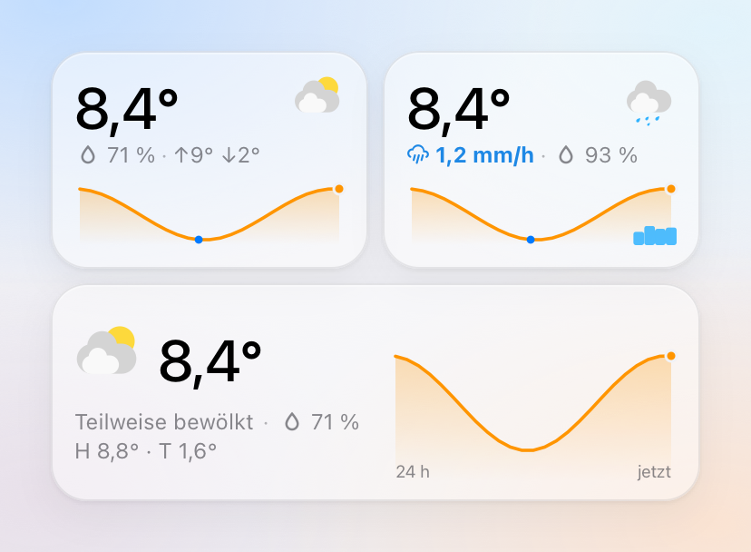

```yaml
type: custom:weather-summary-card
temperature: sensor.outdoor_temperature
humidity: sensor.outdoor_humidity
condition: weather.forecast_home
rain_rate: sensor.rain_rate
layout: auto # auto | half | full
```

### Forecast

The coming days on one shared temperature scale.

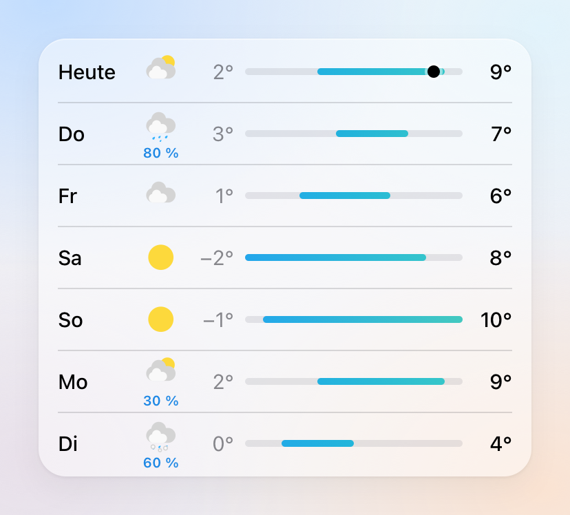

```yaml
type: custom:forecast-days-card
entity: weather.forecast_home
temperature: sensor.outdoor_temperature # optional: today's dot
```

### Rain

Rain today, with any totals you choose beside it and the last 14 days as bars.

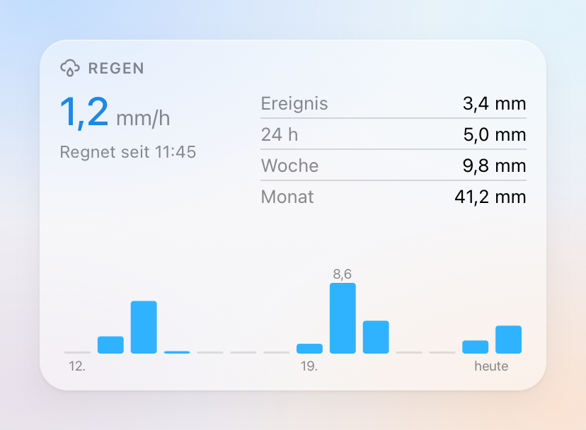

```yaml
type: custom:rain-card
today: sensor.rain_today
rate: sensor.rain_rate
rows:
  - { entity: sensor.rain_event, name: Ereignis }
  - entity: sensor.rain_week
  - entity: sensor.rain_month
```

### Wind

Wind speed, gusts and direction on a compass.

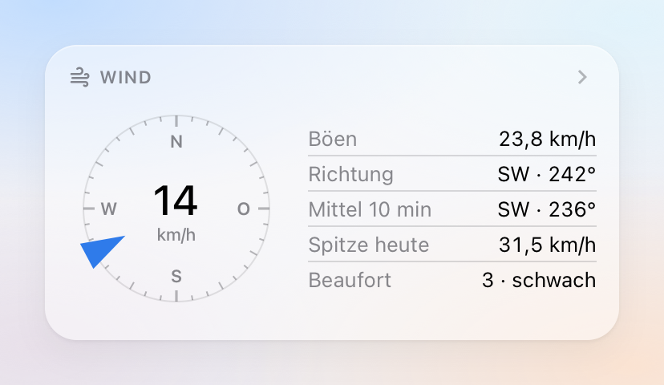

```yaml
type: custom:wind-card
speed: sensor.wind_speed
gust: sensor.wind_gust
direction: sensor.wind_direction
direction_avg: sensor.wind_direction_10m_avg
max_today: sensor.max_daily_gust
```

### Level

A value on a coloured scale, such as the UV index or air quality.

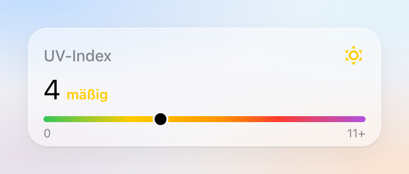

```yaml
type: custom:level-card
entity: sensor.uv_index
max: 11
levels:
  - { from: 0, word: niedrig, color: "#34C759" }
  - { from: 3, word: mäßig, color: "#FFCC00" }
  - { from: 6, word: hoch, color: "#FF9500" }
  - { from: 8, word: sehr hoch, color: "#FF3B30" }
```

### Waste pickups

The next pickup per bin. It reads a sensor with a `termine` list (`art`, `datum`) and an `erledigt` flag.

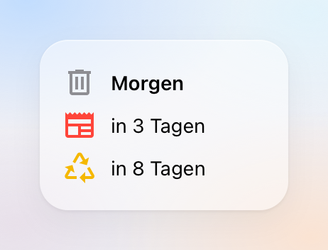

```yaml
type: custom:upcoming-pickups-card
entity: binary_sensor.waste_pickup
bins:
  - { name: Restmüll, icon: mdi:trash-can-outline, color: "#8E8E93" }
  - { name: Altpapier, icon: mdi:newspaper, color: "#FF453A" }
```

### Tab bar

A floating tab bar for a view's footer.

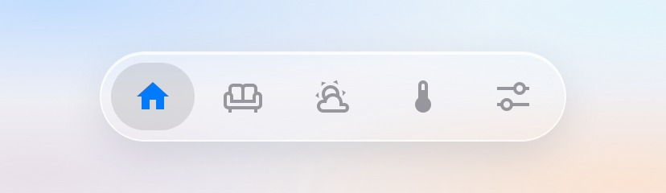

```yaml
footer:
  card:
    type: custom:floating-tab-bar
    tabs:
      - { path: home, icon: mdi:home-outline, label: Home }
      - { path: weather, icon: mdi:weather-partly-cloudy, label: Wetter }
    parent_tab: home # on subpages: the tab to highlight
```

### Filter

Pills that show or hide whole sections of a view.

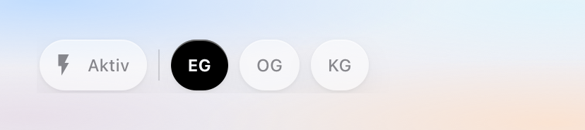

```yaml
header:
  card:
    type: custom:filter-bar
    group: rooms
    default: all
    items:
      - { name: EG, value: eg }
      - { name: OG, value: og }
sections:
  - type: grid
    cards:
      - type: custom:filter-section
        group: rooms
        show_for: [all, eg]
        cards: [...]
```

### Room tile

HA's area card with a photo or colour strip, highlighted while the room is in use. Add [room controls](#room-controls-card-feature) as its buttons, below the name or beside it.

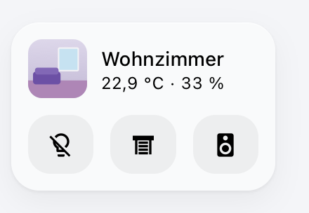

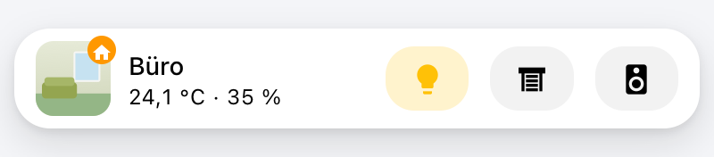

```yaml
type: custom:room-tile-card
area: living_room
identity: photo # photo | photo-large | strip
highlight: room # room | warm | neutral
highlight_entities: [light.living_room]
features_position: bottom # bottom | inline
features:
  - type: custom:room-controls
    controls:
      - entity: light.living_room
      - entity: cover.living_room
      - entity: media_player.living_room
```

### Vacuum

A robot vacuum as a tile, with buttons while it's cleaning.

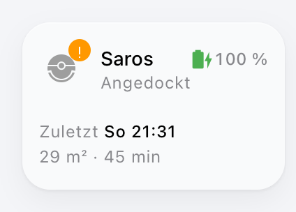

```yaml
type: custom:vacuum-tile-card
entity: vacuum.robot
battery_entity: sensor.robot_battery
features:
  - type: vacuum-commands
    commands: [start_pause, return_home]
```

### Room controls (card feature)

A row of buttons for any card that has features: the room tile, HA's tile and area cards, Mushroom.

```yaml
features:
  - type: custom:room-controls
    controls:
      - entity: light.kitchen
      - entity: switch.coffee_machine
```

## Select on focus

Set `--select-on-focus: 1` on a text field's host, and tapping the field selects its whole value. I use it on a number field from custom-card-features:

```yaml
styles: |
  :host { --select-on-focus: 1; }
```

## License

MIT. To work on the cards, see [DEVELOPMENT.md](DEVELOPMENT.md).
